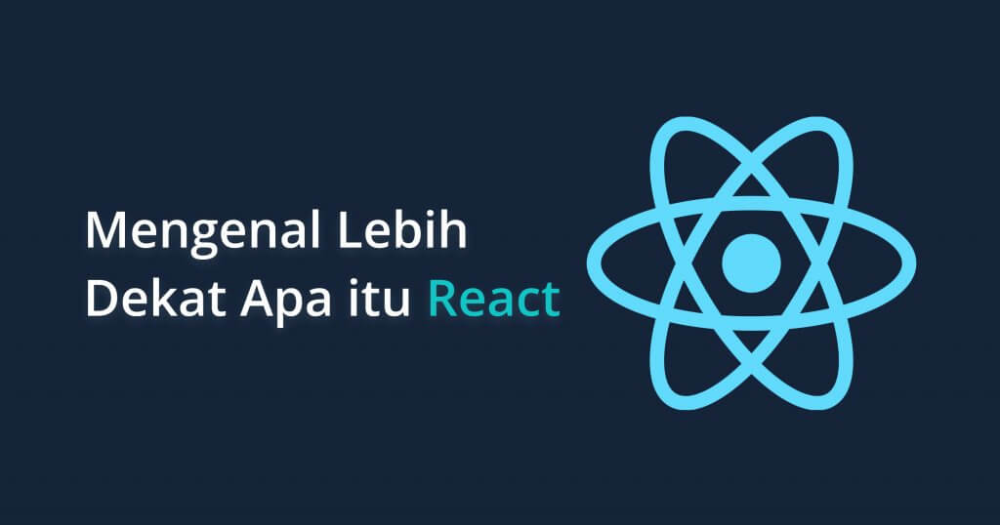

# Mengenal Lebih Dekat Apa itu React

Mungkin untuk kamu yang sudah lama berkecimpung dalam dunia pembuatan website sudah tidak asing lagi mendengar kata React. Apa itu React? Singkatnya, React merupakan sebuah library dari JavaScript yang digunakan untuk membuat user interface. 

## Apa itu React?

React adalah sebuah library **JavaScript** yang digunakan untuk membangun user interface yang interaktif. Library ini dibuat oleh *Facebook* dan bersifat open source. Library ini sangat populer digunakan dan  selalu dikembangkan baik oleh kontributor utama ataupun komunitas. 

React terkenal karena konsep komponen. Di dalam React ada dua tipe komponen, yaitu:

1. **Functional component**
2. **Class component**

### Fitur-Fitur yang Ada di React
- JSX
- Data binding searah

Data binding pada React ini merupakan data binding satu arah. Salah satu kondisinya mungkin dapat terlihat seperti ini:

| Cmponent to View | View to Component |
| ----------- | ----------- |
| Setiap perubahan yang terjadi dalam data component akan terlihat dalam view | Setiap perubahan yang terjadi dalam view akan terlihat juga dalam component |

Sumber: [dicoding](https://www.dicoding.com/blog/apa-itu-react/)
